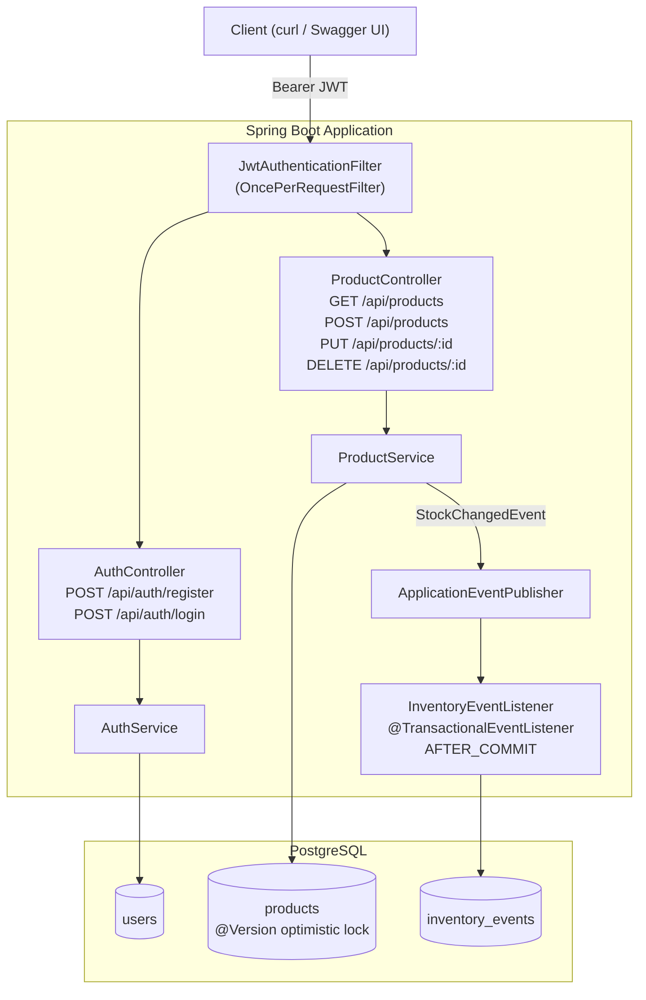

# Inventory Service

A production-ready REST API for inventory management built with Java 21 and Spring Boot 3.3. Features stateless JWT authentication, optimistic locking for concurrent stock updates, and an event-driven audit trail that persists a record of every stock change. Containerised with a multi-stage Docker build and deployed live on Render with GitHub Actions CI.

**Live demo:** https://inventory-service-6i2m.onrender.com/swagger-ui.html

> **Note:** Free tier spins down after inactivity — first request may take ~30 seconds to wake up.

---

## Architecture



---

## Tech Stack

| Layer | Technology |
|---|---|
| Language | Java 21 |
| Framework | Spring Boot 3.3.5 |
| API | Spring Web (REST) |
| Persistence | Spring Data JPA + Hibernate 6 |
| Security | Spring Security 6 — stateless JWT |
| JWT | JJWT 0.12.6 |
| Database | PostgreSQL 16 (prod) / H2 (dev/test) |
| Mapping | MapStruct 1.5.5 |
| Build | Maven 3.9 |
| Containerisation | Docker (multi-stage) + Docker Compose |
| CI | GitHub Actions |
| API Docs | Springdoc OpenAPI / Swagger UI |
| Testing | JUnit 5, Mockito, MockMvc, Testcontainers-ready |

---

## Quickstart (Docker)

**Requirements:** Docker Desktop running.

```bash
git clone https://github.com/NabeelFaridi/inventory-service.git
cd inventory-service

cp .env.example .env
# Edit .env and set DATABASE_PASSWORD and JWT_SECRET
# Generate a secure JWT secret with: openssl rand -base64 32

docker compose up --build
```

App is ready at `http://localhost:8080/swagger-ui.html`.

To verify data persists across restarts:
```bash
docker compose down   # stops containers, keeps named volume
docker compose up     # data is still there
```

To wipe everything:
```bash
docker compose down -v
```

---

## Environment Variables

| Variable | Description |
|---|---|
| `DATABASE_USERNAME` | Postgres username |
| `DATABASE_PASSWORD` | Postgres password |
| `JWT_SECRET` | Base64-encoded 256-bit signing key (`openssl rand -base64 32`) |
| `JWT_EXPIRATION_MS` | Token lifetime in ms (default: `86400000` = 24 h) |

---

## API Endpoints

### Auth (public)

| Method | Endpoint | Description |
|---|---|---|
| `POST` | `/api/auth/register` | Register a new user, returns JWT |
| `POST` | `/api/auth/login` | Login with credentials, returns JWT |

### Products

| Method | Endpoint | Auth | Description |
|---|---|---|---|
| `GET` | `/api/products` | None | List all products |
| `GET` | `/api/products/{id}` | None | Get product by ID |
| `POST` | `/api/products` | Bearer JWT | Create a product |
| `PUT` | `/api/products/{id}` | Bearer JWT | Update a product |
| `DELETE` | `/api/products/{id}` | Bearer JWT | Delete a product |

### Example curl commands

```bash
BASE_URL=https://inventory-service-6i2m.onrender.com

# Register
curl -s -X POST $BASE_URL/api/auth/register \
  -H "Content-Type: application/json" \
  -d '{"username":"alice","password":"password123"}'

# Login
curl -s -X POST $BASE_URL/api/auth/login \
  -H "Content-Type: application/json" \
  -d '{"username":"alice","password":"password123"}'

# Save token
TOKEN=<paste token here>

# Create a product
curl -s -X POST $BASE_URL/api/products \
  -H "Authorization: Bearer $TOKEN" \
  -H "Content-Type: application/json" \
  -d '{"sku":"SKU-001","name":"Widget A","description":"A great widget","price":9.99,"quantity":100}'

# List products (no token needed)
curl -s $BASE_URL/api/products

# Update quantity
curl -s -X PUT $BASE_URL/api/products/1 \
  -H "Authorization: Bearer $TOKEN" \
  -H "Content-Type: application/json" \
  -d '{"sku":"SKU-001","name":"Widget A","price":9.99,"quantity":150}'

# Delete
curl -s -X DELETE $BASE_URL/api/products/1 \
  -H "Authorization: Bearer $TOKEN"
```

---

## JWT Auth Flow

```
1. POST /api/auth/register  →  password BCrypt-hashed, user saved, JWT returned
2. POST /api/auth/login     →  credentials verified, JWT returned

3. Client includes header:  Authorization: Bearer <token>

4. JwtAuthenticationFilter (OncePerRequestFilter):
   - Extracts token from Authorization header
   - Validates signature and expiry with JwtService (JJWT 0.12.x)
   - Loads UserDetails and sets SecurityContext

5. Spring Security enforces:
   - GET /api/products/**  →  public
   - All writes           →  require valid JWT
```

**Why JWT over sessions?** JWTs are stateless — the server holds no session state, making horizontal scaling trivial. Any instance can validate any token.

---

## Event-Driven Stock Tracking

Every time product quantity changes, `ProductService` publishes a `StockChangedEvent` via `ApplicationEventPublisher`. An `@TransactionalEventListener(phase = AFTER_COMMIT)` picks it up and persists an `InventoryEvent` row with the product ID, change type (`STOCK_SET` / `STOCK_INCREASE` / `STOCK_DECREASE`), delta, timestamp, and user ID.

**Why `AFTER_COMMIT`?** If the stock update transaction rolls back, the event listener never fires — so no ghost audit rows are created for failed operations.

**How to scale this?** Replace `ApplicationEventPublisher` with Kafka or RabbitMQ. The listener becomes a separate consumer service with its own database, turning this into a true event-driven microservice.

---

## Optimistic Locking

`Product` has a `@Version Long version` field. If two requests try to update the same product simultaneously, the second one gets an `OptimisticLockException` rather than silently overwriting the first — preventing lost updates on concurrent stock changes.

---

## Running Tests

```bash
mvn test
```

| Test class | Type | What it covers |
|---|---|---|
| `ProductControllerTest` | MockMvc | GET public, POST with auth, POST without auth (403), validation errors (400) |
| `AuthControllerTest` | MockMvc | Register 201, invalid request 400 |
| `ProductServiceTest` | Mockito | Create success + duplicate SKU, findById success + not found |
| `AuthServiceTest` | Mockito | Register success + duplicate username |
| `ProductIntegrationTest` | Spring Boot + H2 | Register → JWT → create product → retrieve product |

---

## CI/CD

GitHub Actions runs on every push to `main`:
1. Sets up Java 21 (Temurin)
2. Runs `mvn verify` (compile + test + package)
3. Uploads surefire test reports as an artifact

Render auto-deploys on every push to `main` via GitHub integration.

---

## Project Structure

```
src/main/java/com/inventory/
├── config/          # SecurityConfig, OpenApiConfig, AppProperties
├── controller/      # ProductController, AuthController
├── dto/             # Request/Response DTOs
├── entity/          # User, Product (@Version), InventoryEvent
├── event/           # StockChangedEvent, InventoryEventListener
├── exception/       # GlobalExceptionHandler (RFC 7807), custom exceptions
├── mapper/          # ProductMapper (MapStruct)
├── repository/      # Spring Data JPA repositories
├── security/        # JwtService, JwtAuthenticationFilter, UserDetailsServiceImpl
└── service/         # ProductService, AuthService
```
